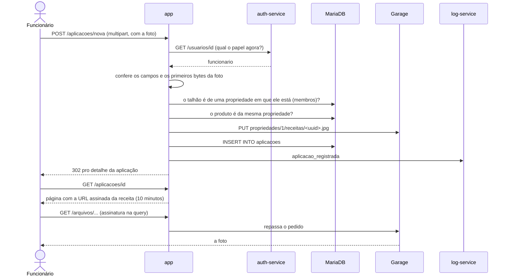
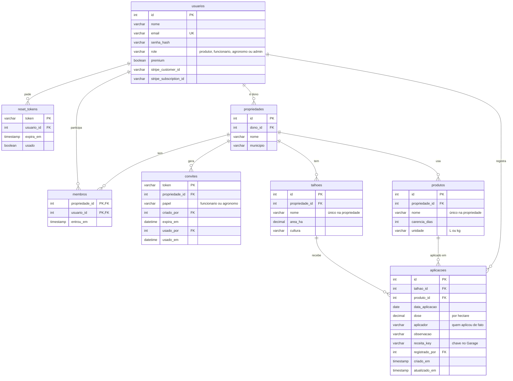

# Documentação do Talhão em Dia

Documentação do sistema depois da troca de domínio da atividade 10. Mesmo formato da atividade 8:
tudo aqui descreve o que o código faz hoje, e cada regra de negócio aponta pra linha de onde ela foi
tirada. O plano de negócio, a arquitetura resumida e como rodar estão no [README](README.md).

1. [Especificação](#1-especificação)
2. [Arquitetura](#2-arquitetura)
3. [Regras de negócio](#3-regras-de-negócio)
4. [Modelo de dados](#4-modelo-de-dados)

---

## 1. Especificação

O Talhão em Dia é o caderno de campo do pequeno produtor de café. Cada propriedade (o sítio) tem
talhões, os produtos que usa e o caderno com as aplicações. A partir da carência de cada produto, o
sistema mostra quando cada talhão está liberado pra colher. O produtor convida o funcionário e o
agrônomo pra mesma propriedade, e cada pessoa só enxerga as propriedades de que faz parte.

### Quem usa

| Perfil | O que pode fazer |
|---|---|
| Visitante (sem login) | Ver a landing page, criar conta de produtor ou de agrônomo, entrar, pedir a recuperação de senha e abrir um link de convite. |
| Produtor (`produtor`) | Cadastrar a propriedade; cadastrar, editar e apagar talhões e produtos; registrar, editar e apagar qualquer aplicação da propriedade; convidar funcionário e agrônomo; assinar o Pro. |
| Funcionário (`funcionario`) | Só entra por convite. Vê os talhões, produtos e o caderno da propriedade em que entrou; registra aplicações e edita ou apaga só as que ele mesmo registrou. |
| Agrônomo (`agronomo`) | Cria a conta sozinho ou pelo convite. Vê os talhões, produtos e o caderno das propriedades que o convidaram, sem alterar nada. |
| Administrador (`admin`) | Papel da plataforma: consulta o log de auditoria. Não faz parte de nenhuma propriedade, então não vê dado de cliente. Só muda direto no banco. |

### Landing, cadastro e login

- **/** é a landing page: a dor, como funciona, a tabela Free × Pro e os botões **Criar conta
  grátis** e **Criar conta de agrônomo**. Quem já entrou é mandado direto pros talhões (ou pro log,
  se for admin).
- Em **/cadastro** a pessoa escolhe "Sou produtor" ou "Sou agrônomo" e informa nome, e-mail e
  senha. Funcionário não aparece ali: entra só pelo convite.
- Em **/login** entra com e-mail e senha. Errando qualquer um dos dois, a mensagem é sempre "E-mail
  ou senha inválidos.".
- **/esqueci-senha** e **/resetar-senha** continuam como antes: link por e-mail, válido por 30
  minutos e de uso único.

### Propriedade e equipe

- O produtor sem propriedade é mandado pra **/propriedade/nova** (nome do sítio e município) e
  depois direto pro cadastro do primeiro talhão.
- **Equipe** lista quem faz parte da propriedade, com o papel e a data em que entrou, e tem os
  botões **Convidar funcionário** e **Convidar agrônomo**. Cada clique gera um link que vale 7 dias
  e uma vez só, com os botões **Copiar** e **WhatsApp**.
- Quem abre o link sem estar logado vê "Você foi convidado pra entrar na propriedade X como
  funcionário" e cria a conta ali mesmo, já dentro da propriedade. Um agrônomo que já tem conta
  entra e aceita com **Acompanhar a propriedade**.

### Talhões e carência

- **Talhões** é a página inicial: um cartão por talhão, agrupado por propriedade, com área, cultura,
  quantas aplicações tem e a situação:
  - "em carência até 30/11/2026 · faltam 33 dias", em vermelho;
  - "liberado pra colher desde 15/10/2026", em verde;
  - "sem aplicação registrada".
- O detalhe do talhão mostra a mesma situação e as aplicações feitas nele. **Editar** e **Apagar**
  só aparecem pro produtor.

### Produtos

- Tabela com nome, carência, unidade da dose (L/ha ou kg/ha) e em quantas aplicações o produto
  aparece. O produtor cadastra embaixo e edita ou apaga em cada linha; **Apagar** só aparece em
  produto que nunca foi aplicado.

### Caderno de campo (aplicações)

- **Caderno** lista as aplicações da mais recente pra mais antiga, com filtro por talhão: data,
  talhão, produto, dose, quem aplicou, até quando dura a carência (em vermelho se ainda não passou)
  e um 📎 quando tem receita.
- **Registrar aplicação** é um formulário de uma coluna, pensado pro celular: talhão, produto (com a
  carência no nome), data (hoje, por padrão), dose por hectare, quem aplicou (o nome de quem está
  logado, por padrão), observação e a foto ou PDF da receita.
- O detalhe mostra dose, carência, a data em que libera o talhão, quem aplicou, quem registrou e
  quando, a observação e a receita (a foto aparece na página; o PDF abre num link).

### Plano

- **Plano** mostra a tabela Free × Pro e, pro produtor, o botão **Assinar o Pro com Stripe**. O
  checkout, o webhook e o retorno ("Pagamento enviado", "Pagamento cancelado") funcionam como no
  plano pago da P1.

### Log de auditoria (admin)

- **/admin/logs** mostra os últimos 50 eventos (`?n=` vai até 500): quando (horário de Brasília),
  quem (nome e id), ação, serviço, IP e detalhes. **Só eventos do negócio** esconde login, logout e
  erros.

---

## 2. Arquitetura

O diagrama dos serviços e de como eles conversam está no [README](README.md#arquitetura). A stack
é a mesma da P1; mudou o que roda dentro do app.

### Exemplo de fluxo: registrar uma aplicação com receita

### SaaS, PaaS e IaaS

A infraestrutura não mudou na troca de domínio, então a classificação é a mesma da atividade 8, só
sem a API de dados externa, que saiu:

| Peça | Camada | Por quê |
|---|---|---|
| VM do servidor da disciplina (Ubuntu + Docker) | **IaaS** | É a máquina virtual onde a stack roda. Do sistema operacional pra cima, quem instala e mantém é a disciplina. |
| Portainer + Docker do servidor | **PaaS** | É onde eu faço o deploy: entrego o `docker-compose.yml` e as imagens, e a plataforma cuida do runtime, da rede, dos volumes e de reiniciar o que cair. |
| Containers do app, auth-service e log-service | **PaaS** | Meu código empacotado em imagem (GHCR), rodando na plataforma acima. |
| Redis e Garage (no lugar do MinIO) | **PaaS** | Containers da stack, na mesma plataforma, com configuração minha (persistência, bucket, chaves). |
| MariaDB da disciplina | **PaaS** | Banco entregue pronto: recebo host, usuário e um schema. |
| Stripe | **SaaS** | Checkout e assinatura prontos; o cartão não passa pelo sistema. |
| Brevo (produção) / Mailtrap (dev) | **SaaS** | E-mail transacional por SMTP. |
| Cloudflare | **SaaS** | HTTPS e proxy na frente do `lapps.studio`. |
| GitHub (repositório, issues, Actions) e GHCR | **SaaS** | Pipeline descrito num YAML e rodado nas máquinas do GitHub; o GHCR guarda as imagens. |

E o próprio Talhão em Dia é um **SaaS** do ponto de vista do produtor: ele não instala nada, usa
pelo navegador do celular e paga por mês.

---

## 3. Regras de negócio

Tiradas lendo o código, no formato "se X, então Y". O link de cada uma vai pra linha onde ela está.

### Cadastro, login e papéis

1. **Se** alguém se cadastra pela página aberta, **então** só pode escolher produtor ou agrônomo;
   qualquer outro papel no formulário dá `400`. — [`app/auth.py:13`](app/auth.py#L13),
   [`:99`](app/auth.py#L99)
2. **Se** o pedido de cadastro chega no auth-service com `admin` (ou qualquer papel fora de
   produtor, funcionário e agrônomo), **então** é recusado com `400`: admin nunca nasce pelo
   cadastro. — [`auth-service/app.py:46`](auth-service/app.py#L46), [`:160`](auth-service/app.py#L160)
3. **Se** o e-mail já tem conta, **então** o cadastro dá `409`; o e-mail é comparado sem espaços e
   em minúsculas. — [`auth-service/app.py:170`](auth-service/app.py#L170)
4. **Se** uma senha é cadastrada ou trocada, **então** só o hash vai pro banco. —
   [`auth-service/app.py:163`](auth-service/app.py#L163), [`:548`](auth-service/app.py#L548)
5. **Se** o e-mail não existe ou a senha não bate, **então** o login falha com a mesma mensagem e
   vira `login_falhou` no log. — [`auth-service/app.py:239-240`](auth-service/app.py#L239-L240)
6. **Se** o login dá certo, **então** a sessão anterior é apagada e a nova guarda só id, nome e
   papel; o papel da sessão serve só pra montar o menu. — [`app/auth.py:135-138`](app/auth.py#L135-L138)
7. **Se** o login veio de um link de convite, **então** volta pra ele depois de entrar, mas só se o
   destino for um caminho do próprio site. — [`app/auth.py:141`](app/auth.py#L141)
8. **Se** a requisição precisa saber o papel, **então** ele é perguntado ao auth-service naquela
   hora (Padrão A); se o auth-service não responde, a resposta é `503`. —
   [`app/acesso.py:24-31`](app/acesso.py#L24-L31)
9. **Se** o papel não tem a permissão da ação, **então** a resposta é `403` antes de olhar qualquer
   registro, mesmo que o id exista. — [`app/acesso.py:9`](app/acesso.py#L9),
   [`:46-51`](app/acesso.py#L46-L51)
10. **Se** a API é chamada sem login, **então** responde `401` em JSON (as telas mandam pro
    `/login`). — [`app/auth.py:72`](app/auth.py#L72)

### Propriedade e convites

11. **Se** quem tenta cadastrar uma propriedade não é produtor, **então** `403`; **se** o produtor
    já tem uma, **então** volta pros talhões (uma propriedade por produtor, por enquanto). —
    [`app/propriedade.py:25-29`](app/propriedade.py#L25-L29)
12. **Se** a propriedade é criada, **então** o dono entra junto como membro dela. —
    [`app/propriedade.py:49`](app/propriedade.py#L49)
13. **Se** o produtor gera um convite, **então** o link tem um token aleatório, vale 7 dias e só pode
    ser de funcionário ou agrônomo. — [`app/propriedade.py:14`](app/propriedade.py#L14),
    [`:120-122`](app/propriedade.py#L120-L122)
14. **Se** o convite não existe, já foi usado ou venceu, **então** a página dá `404`. —
    [`app/propriedade.py:155`](app/propriedade.py#L155)
15. **Se** alguém sem login aceita o convite, **então** a conta é criada com o papel do convite e já
    entra na propriedade; o convite fica marcado com quem usou. —
    [`app/propriedade.py:200`](app/propriedade.py#L200), [`:160-166`](app/propriedade.py#L160-L166)
16. **Se** quem abre o convite já está logado, **então** só aceita se o convite for de agrônomo e a
    conta também; qualquer outra combinação só mostra o aviso. —
    [`app/propriedade.py:185`](app/propriedade.py#L185)

### Isolamento por propriedade

17. **Se** um talhão, produto ou aplicação é de uma propriedade de que o usuário não faz parte,
    **então** ele não aparece em lista nenhuma e, aberto pelo id (tela ou API), dá `404`, igual a
    um id que não existe. Toda consulta passa pela tabela `membros`. —
    [`app/caderno.py:179`](app/caderno.py#L179), [`:494-514`](app/caderno.py#L494-L514)
18. **Se** alguém registra uma aplicação com o id de um talhão de outra propriedade, **então** é
    recusado com a mesma mensagem de um talhão que não existe. —
    [`app/caderno.py:506`](app/caderno.py#L506)
19. **Se** o produto escolhido não é da mesma propriedade do talhão, **então** a aplicação é
    recusada. — [`app/caderno.py:514`](app/caderno.py#L514)
20. **Se** uma aplicação é editada pra um talhão de outra propriedade, **então** é recusada. —
    [`app/caderno.py:568`](app/caderno.py#L568)

### Talhões e produtos

21. **Se** quem tenta cadastrar, editar ou apagar talhão ou produto não é o produtor dono da
    propriedade, **então** `403`. — [`app/caderno.py:235`](app/caderno.py#L235),
    [`:264`](app/caderno.py#L264), [`:289`](app/caderno.py#L289)
22. **Se** já existe um talhão (ou produto) com o mesmo nome na propriedade, **então** `409`. —
    [`app/caderno.py:252`](app/caderno.py#L252), [`db/001_dominio.sql:58`](db/001_dominio.sql#L58)
23. **Se** o talhão tem aplicações, **então** não pode ser apagado (`409`): o histórico do caderno
    não some junto. — [`app/caderno.py:295`](app/caderno.py#L295)
24. **Se** o produto já foi aplicado, **então** também não pode ser apagado. —
    [`app/caderno.py:415`](app/caderno.py#L415)
25. **Se** a área ou a dose não é um número maior que zero, **então** é recusada; vírgula vale como
    separador decimal. — [`app/caderno.py:58`](app/caderno.py#L58)
26. **Se** a carência não está entre 0 e 365 dias, ou a unidade não é L ou kg, **então** o produto é
    recusado. — [`app/caderno.py:94`](app/caderno.py#L94)

### Aplicações e carência

27. **Se** quem tenta registrar é agrônomo ou admin, **então** `403`. —
    [`app/acesso.py:9`](app/acesso.py#L9), [`app/caderno.py:526`](app/caderno.py#L526)
28. **Se** a data da aplicação é depois de hoje (no dia de Brasília), **então** é recusada. —
    [`app/caderno.py:76`](app/caderno.py#L76), [`:36`](app/caderno.py#L36)
29. **Se** quem edita ou apaga é funcionário, **então** só passa nas aplicações que ele mesmo
    registrou; o produtor passa em todas da propriedade dele. —
    [`app/caderno.py:474`](app/caderno.py#L474), [`:484`](app/caderno.py#L484)
30. **Se** o talhão tem aplicações, **então** ele fica liberado no dia em que vence a carência mais
    longa entre elas (data da aplicação + carência do produto); antes disso, aparece em carência com
    os dias que faltam. — [`app/caderno.py:176`](app/caderno.py#L176),
    [`:185`](app/caderno.py#L185)
31. **Se** a carência de um produto é corrigida, **então** a data de liberação dos talhões em que ele
    já foi aplicado muda junto, porque ela é calculada na hora e não gravada. —
    [`app/caderno.py:176`](app/caderno.py#L176)

### Receita (upload)

32. **Se** o arquivo passa de 8 MB, **então** é recusado; **se** a requisição inteira passa de 10 MB,
    o Flask corta antes de chegar na rota (`413`). — [`app/caderno.py:138`](app/caderno.py#L138),
    [`app/__init__.py:27`](app/__init__.py#L27)
33. **Se** os primeiros bytes não são de JPG, PNG, WebP ou PDF, **então** a receita é recusada; a
    extensão e o `Content-Type` mandados pelo navegador não contam. —
    [`app/caderno.py:124`](app/caderno.py#L124)
34. **Se** a receita é aceita, **então** vai pro Garage com a chave
    `propriedades/<propriedade>/receitas/<uuid>.<ext>` e o banco guarda só a chave. —
    [`app/caderno.py:154`](app/caderno.py#L154)
35. **Se** a aplicação é editada sem arquivo novo, **então** a receita atual continua; com arquivo
    novo, a antiga só sai do Garage depois que o banco já aponta pra nova. —
    [`app/caderno.py:575`](app/caderno.py#L575), [`:591-592`](app/caderno.py#L591-L592)
36. **Se** a aplicação é apagada, **então** a receita sai do Garage junto. —
    [`app/caderno.py:625`](app/caderno.py#L625)
37. **Se** alguém abre a receita, **então** recebe uma URL assinada que vale 10 minutos; vencida ou
    adulterada, o Garage responde `403`. — [`app/storage.py:6`](app/storage.py#L6),
    [`app/arquivos.py:22`](app/arquivos.py#L22)

### Plano (Stripe)

38. **Se** quem tenta assinar não é produtor, **então** `403`; **se** já é Pro, não abre outro
    checkout. — [`app/plano.py:62-63`](app/plano.py#L62-L63)
39. **Se** o webhook chega sem `Stripe-Signature` válida ou com horário de mais de 5 minutos,
    **então** é recusado com `400` e vai pro log como `webhook_recusado`. —
    [`app/plano.py:96-100`](app/plano.py#L96-L100)
40. **Se** o auth-service não consegue gravar o plano, **então** o webhook responde `503` e o Stripe
    manda o mesmo evento depois. — [`app/plano.py:115-118`](app/plano.py#L115-L118)

### Auditoria

41. **Se** qualquer rota responde `403`, da tela ou da API, **então** vira `acesso_negado` no log com
    o método e o caminho. — [`app/__init__.py:83-85`](app/__init__.py#L83-L85)
42. **Se** um registro do caderno é criado, editado ou apagado, **então** vira um evento de negócio
    no log; a edição leva o antes e o depois de cada campo que mudou. —
    [`app/caderno.py:631`](app/caderno.py#L631)
43. **Se** quem abre `/admin/logs` não é admin, **então** `403`. — [`app/admin.py:44`](app/admin.py#L44)
44. **Se** o log-service está fora do ar, **então** a ação do usuário segue normalmente e o evento se
    perde. — [`app/auditoria.py:33`](app/auditoria.py#L33)

### O que a leitura do código mostrou fora das regras

- **O menu usa o papel da sessão; o backend, não.** Se o papel de alguém mudar no banco, o menu fica
  desatualizado até a pessoa relogar, mas o que ela consegue fazer já muda na hora.
- **Não dá pra tirar alguém da equipe pela tela.** O convite só adiciona; remover um funcionário
  hoje é direto no banco.
- **O plano ainda é do usuário, não da propriedade.** O checkout e o webhook vieram da P1 do jeito
  que eram; a troca pra propriedade e o limite de 2 talhões no Free são a atividade 11.

---

## 4. Modelo de dados

O sistema guarda dados em três lugares: o **MariaDB** (tabelas), o **Redis** (log de auditoria) e o
**Garage** (receitas). Os pagamentos ficam no Stripe.

### Tabelas no MariaDB

Criadas por [`db/000_contas.sql`](db/000_contas.sql) e [`db/001_dominio.sql`](db/001_dominio.sql).

| Tabela | Dono | Observações |
|---|---|---|
| `usuarios`, `reset_tokens` | auth-service | O app nunca lê nem escreve aqui: nome, papel e plano vêm pela API do auth-service. |
| `propriedades` | app | O "cliente" do SaaS. `dono_id` é o produtor que criou. |
| `membros` | app | Quem faz parte de cada propriedade, inclusive o dono. É por ela que passa todo o isolamento. |
| `convites` | app | Uso único: depois de aceito, `usado_por` e `usado_em` ficam preenchidos. |
| `talhoes`, `produtos` | app | `UNIQUE (propriedade_id, nome)`. Não têm `ON DELETE CASCADE`: com aplicação ligada, não apagam. |
| `aplicacoes` | app | `aplicador` é texto porque quem aplicou pode ser um diarista sem conta; `registrado_por` é sempre um usuário. A data de liberação não é gravada: é `data_aplicacao + carencia_dias`, calculada na consulta. |

As tabelas do catálogo da P1 (`favoritos`, `comentarios`, `perfis`) foram apagadas pela
`001_dominio.sql`; o histórico delas continua no git.

### Log de auditoria (Redis)

Cada evento é uma entrada do stream `auditoria`, com `usuario_id`, `acao`, `timestamp` (relógio do
log-service, em UTC), `ip`, `servico` (`app` ou `auth`) e `detalhes`. Os eventos do negócio:

| Ação | Quando | Exemplo de detalhes |
|---|---|---|
| `conta_criada` | cadastro pela página aberta | `produtor` |
| `propriedade_criada` | produtor cadastra o sítio | `propriedade Sítio Boa Vista (1), Garça` |
| `convite_criado` / `convite_aceito` | link gerado / conta criada ou agrônomo aceitou | `funcionario na propriedade Sítio Boa Vista (1)` |
| `talhao_criado` / `talhao_editado` / `talhao_apagado` | CRUD de talhão | `talhão Alto (2): área 5,00 → 5,50` |
| `produto_cadastrado` / `produto_editado` / `produto_apagado` | CRUD de produto | `produto Fungicida cúprico (1), carência de 7 dias` |
| `aplicacao_registrada` | aplicação nova | `aplicação 6: Herbicida pós-emergente, 1,50 L/ha no talhão Divisa (4) em 27/10/2026, aplicado por Diego, com receita` |
| `aplicacao_editada` | edição | `aplicação 6: dose 1,50 → 2,00` |
| `aplicacao_apagada` | aplicação apagada | o mesmo resumo da registrada |
| `checkout_pro` / `pro_ativado` / `pro_cancelado` | assinatura | id da sessão ou da assinatura no Stripe |

Fora do negócio continuam `login`, `login_falhou`, `logout`, `acesso_negado` e `webhook_recusado`.

### Receitas (Garage)

Bucket privado, um objeto por receita, com chave `propriedades/<propriedade_id>/receitas/<uuid>.<ext>`.
A coluna `aplicacoes.receita_key` aponta pro objeto atual. Pra ver o que está guardado:
`flask --app run arquivos` dentro do container do app.

### Sessão de login

Não fica no banco: é um cookie assinado pelo Flask (com a `SECRET_KEY`) contendo `usuario_id`, `nome`
e `role`.
