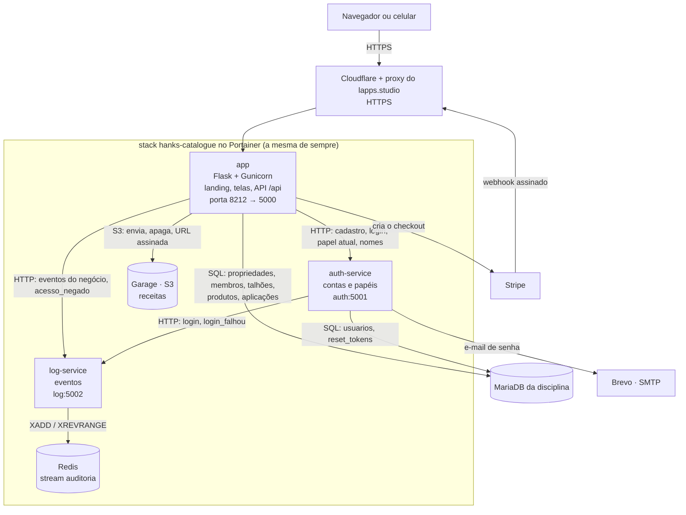
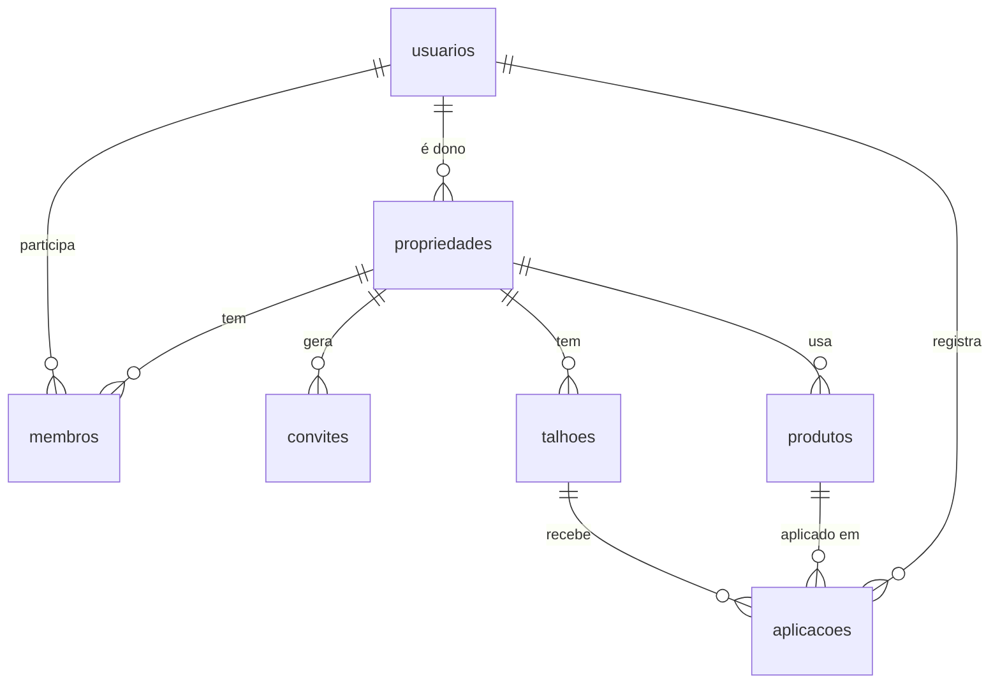

# 🌱 Talhão em Dia

**Caderno de campo no celular pro pequeno produtor de café: cada aplicação registrada por talhão, aviso de quando a carência acaba e o histórico pronto quando a cooperativa ou a certificadora pedir.**

**No ar:** [joao-alegre-isw055.lapps.studio](https://joao-alegre-isw055.lapps.studio/)

Este repositório continua o [Hanks-catalogue](https://github.com/joao-alegre07/Hanks-catalogue), o
projeto da P1, com todo o histórico. Login, papéis, log, upload e Stripe vieram de lá e só mudaram
de assunto; a stack no Portainer e o endereço são os mesmos.

- [O que o sistema faz](#o-que-o-sistema-faz)
- [Como testar](#como-testar)
- [Arquitetura](#arquitetura)
- [Papéis e isolamento](#papéis-e-isolamento)
- [Banco de dados e migrações](#banco-de-dados-e-migrações)
- [API](#api)
- [Rodando local](#rodando-local)
- [Deploy](#deploy)
- [Plano de negócio](#plano-de-negócio)

A especificação completa, as regras de negócio (com a linha do código de cada uma) e a
classificação SaaS/PaaS/IaaS estão em [DOCUMENTACAO.md](DOCUMENTACAO.md).

## O que o sistema faz

- **Landing page aberta** na raiz, com a proposta de valor, os planos e o botão de criar conta.
- **Propriedade e talhões.** O produtor cadastra o sítio e os talhões (nome, área, cultura).
- **Produtos** com a carência que está na bula.
- **Caderno de campo**, o recurso principal: cada aplicação tem talhão, produto, dose por hectare,
  data, quem aplicou, observação e a **foto ou PDF da receita**, guardada no Garage (S3).
- **Carência por talhão:** cada talhão mostra "em carência até 30/11/2026 · faltam 33 dias" ou
  "liberado pra colher", contando a aplicação de carência mais longa.
- **Equipe por convite:** o produtor gera um link (vale 7 dias, uma vez só) e manda pelo WhatsApp.
  Quem abre cria a conta já dentro da propriedade, como funcionário ou agrônomo.
- **Log de auditoria** com os eventos do negócio (quem, o quê, quando), só pra admin.
- **Plano Pro** pelo Stripe (modo de teste), com checkout e webhook.

## Como testar

O roteiro abaixo é o do enunciado, no endereço de produção.

1. Abrir [joao-alegre-isw055.lapps.studio](https://joao-alegre-isw055.lapps.studio/) sem login:
   aparece a landing page.
2. **Criar conta grátis** → "Sou produtor". Depois de entrar, o sistema pede a propriedade e em
   seguida o primeiro talhão.
3. Em **Produtos**, cadastrar um defensivo com a carência (ex.: 30 dias).
4. **Registrar aplicação** com uma foto da receita; abrir a aplicação, **Editar** e **Apagar**. O
   talhão muda de "sem aplicação" pra "em carência até ...".
5. Numa janela anônima, criar a segunda conta, agora "Sou agrônomo". Ela não faz parte da
   propriedade da primeira, então:
   - trocar o id na URL pra um talhão ou aplicação da primeira conta (`/talhoes/<id>`,
     `/aplicacoes/<id>`, `/api/aplicacoes/<id>`) dá **404**;
   - tentar registrar uma aplicação direto na API dá **403**, porque agrônomo só acompanha. No
     console do navegador:

     ```js
     fetch("/api/aplicacoes", {method: "POST", headers: {"Content-Type": "application/json"}, body: "{}"})
       .then(r => console.log(r.status))
     ```
6. Com a primeira conta, em **Equipe → Convidar funcionário**, o link abre uma tela de cadastro já
   dentro da propriedade. O funcionário registra aplicações, mas `DELETE /api/talhoes/<id>` dá 403.
7. Como admin, **Log → Só eventos do negócio** mostra `talhao_criado`, `aplicacao_registrada`,
   `aplicacao_editada`, `aplicacao_apagada` e os outros, com o nome de quem fez e o horário.

## Arquitetura



| Serviço | O que faz | Porta | Fala com |
|---|---|---|---|
| **app** (`app/`) | Único ponto de entrada: landing, telas, API do caderno, convites, plano e o log pro admin. | `8212` no host → `5000` | auth, log, Garage, MariaDB, Stripe |
| **auth-service** | Cadastro com papel, login, papel e plano atuais, nomes em lote, recuperação de senha. Único que escreve em `usuarios`. | `5001`, só na rede do Docker | MariaDB, log, SMTP |
| **log-service** | Recebe os eventos e devolve os últimos N. Único que fala com o Redis. | `5002`, só na rede do Docker | Redis |
| **Redis** | Stream `auditoria`, com `appendonly` e volume próprio. | só na rede do Docker | — |
| **Garage** | Object storage compatível com S3 (no lugar do MinIO): as receitas das aplicações, em bucket privado. | só na rede do Docker | — |
| **MariaDB** | Banco da disciplina, fora da stack. | — | — |

Só o app tem porta publicada. A receita chega no navegador por uma URL assinada que vale 10
minutos, passando pela rota `/arquivos` do app, que só repassa o pedido pro Garage.

## Papéis e isolamento

O sistema é multi-tenant: todas as propriedades estão no mesmo banco e nos mesmos containers, e
cada uma é um "cliente". A tabela `membros` diz quem faz parte de qual propriedade, e **toda
consulta passa por ela**: o que é de outra propriedade não aparece em lista nenhuma e, aberto pelo
id, responde **404**, igual a um id que não existe.

O papel fica no auth-service e é perguntado a cada requisição (Padrão A), nunca lido da sessão:

| | produtor | funcionário | agrônomo | admin |
|---|---|---|---|---|
| Como entra | cadastro aberto | só por convite | cadastro aberto ou convite | direto no banco |
| Ver talhões, produtos e caderno | ✅ da propriedade dele | ✅ da propriedade em que entrou | ✅ das que acompanha | — |
| Cadastrar, editar e apagar talhões e produtos | ✅ | 403 | 403 | 403 |
| Registrar aplicação | ✅ | ✅ | 403 | 403 |
| Editar e apagar aplicação | ✅ qualquer uma | ✅ só as que registrou | 403 | 403 |
| Convidar pra equipe, assinar o Pro | ✅ | 403 | 403 | 403 |
| Ver o log | 403 | 403 | 403 | ✅ |

O papel é conferido antes de olhar o registro, então a ação proibida dá 403 mesmo com um id que
existe. Todo 403, da tela ou da API, vira um evento `acesso_negado` no log com o método e o caminho.

## Banco de dados e migrações



Os scripts ficam em [`db/`](db) e rodam em ordem:

| Arquivo | O que faz |
|---|---|
| [`000_contas.sql`](db/000_contas.sql) | Tabelas do auth-service (`usuarios`, `reset_tokens`), que já existiam desde o começo. |
| [`001_dominio.sql`](db/001_dominio.sql) | Domínio: `propriedades`, `membros`, `convites`, `talhoes`, `produtos` e `aplicacoes`. Troca o papel `usuario` por `produtor` e apaga as tabelas antigas que não servem mais. Pode rodar de novo sem estragar nada. |
| [`seed.sql`](db/seed.sql) | Dados de exemplo pra rodar local: duas propriedades, cinco contas (uma de cada papel e uma produtora de outra propriedade), talhões, produtos e aplicações. **Não roda em produção**: as contas têm senha conhecida. |

Quem clona o repositório recria o banco com as migrações e o seed (o compose de desenvolvimento faz
isso sozinho na primeira subida). Em produção, as migrações rodam uma vez contra o banco da
disciplina:

```bash
mariadb -h "$DB_HOST" -u "$DB_USER" -p "$DB_NAME" < db/001_dominio.sql
```

## API

JSON, com a mesma sessão das telas (cookie). Tela e API chamam as mesmas funções de
[`app/caderno.py`](app/caderno.py), então as regras de papel e de propriedade são as mesmas nos dois
caminhos. A documentação, com "Try it out", fica em
[`/apidocs`](https://joao-alegre-isw055.lapps.studio/apidocs).

| Método | Rota | O quê |
|---|---|---|
| `GET` `POST` | `/api/aplicacoes` | lista (filtro `?talhao_id=`) / registra, em JSON ou multipart com a `receita` |
| `GET` `PUT` `DELETE` | `/api/aplicacoes/<id>` | detalha / edita / apaga |
| `GET` `POST` | `/api/talhoes` | lista com a carência / cadastra |
| `GET` `PUT` `DELETE` | `/api/talhoes/<id>` | detalha / edita / apaga (409 se tiver aplicação) |
| `GET` `POST` | `/api/produtos` | lista / cadastra |
| `PUT` `DELETE` | `/api/produtos/<id>` | edita / apaga (409 se já foi aplicado) |

Sem login a API responde 401; papel sem permissão, 403; registro de outra propriedade, 404.

## Rodando local

```bash
cp .env.example .env
```

Preencher o `.env` (o `DB_HOST` pode ficar vazio: o compose de desenvolvimento sobe um MariaDB
próprio) e subir:

```bash
docker compose -f docker-compose.dev.yml up --build
```

O app fica em http://localhost:5000, com o seed já carregado. Todas as contas do seed têm a senha
`talhao123`: `marcos@talhaoemdia.local` (produtor), `diego@talhaoemdia.local` (funcionário),
`ana@talhaoemdia.local` (agrônoma), `rita@talhaoemdia.local` (produtora de outra propriedade) e
`admin@talhaoemdia.local`. O Grafana fica em http://localhost:3000.

As receitas guardadas no Garage dá pra listar de dentro do container do app:

```bash
docker compose -f docker-compose.dev.yml exec app flask --app run arquivos
```

### Testes

Os testes do app sobem o app e o auth-service juntos, contra um MariaDB de verdade criado pelas
migrações, e seguem o roteiro do enunciado: duas propriedades, 404 entre elas, 403 por papel,
convite, carência, upload e o log. Localmente precisam de um MariaDB na porta 3307:

```bash
docker run -d --name talhao-teste-db -e MARIADB_ROOT_PASSWORD=root -e MARIADB_DATABASE=talhao_teste -e MARIADB_USER=teste -e MARIADB_PASSWORD=teste -p 3307:3306 mariadb:11
```

```bash
python -m pytest tests && (cd auth-service && python -m pytest) && (cd log-service && python -m pytest)
```

No GitHub Actions esse MariaDB é um service do job de testes.

## Deploy

A cada push na `main` o GitHub Actions roda os testes, publica as imagens
`ghcr.io/joao-alegre07/talhao-em-dia-{app,auth,log,garage}` com a tag `sha-<commit>` e tenta
atualizar a stack pela API do Portainer, mandando o `docker-compose.yml` do commit e a `IMAGE_TAG`
nova. O Cloudflare na frente do Portainer ainda barra os runners do GitHub, então o último passo é
um clique: `IMAGE_TAG` = `sha-<commit>` na stack e **Update the stack** com "Re-pull image and
redeploy" ligado.

A stack é a mesma desde a P1 (`hanks-catalogue`), com as mesmas variáveis de ambiente e o mesmo
subdomínio. Ela nasceu ligada ao repositório Git do Hanks-catalogue, e o Portainer do servidor
(2.39 CE) não deixa trocar a URL do repositório de uma stack Git, nem pela tela nem pela API. Pra
não criar uma stack nova, ela foi desconectada do Git na troca: o compose dela é o deste repositório
e as imagens são as que este CI publica, então o repositório antigo não alimenta mais nada.

## Plano de negócio

Escrito na atividade 9, antes do código.

### A dor

**Quem sofre:** o pequeno produtor de café da região de Garça, Pompeia e Marília, com 10 a 30
hectares divididos em poucos talhões, que toca o sítio com a família e um ou dois funcionários e é
atendido por um agrônomo de cooperativa ou de revenda que passa a cada 15 dias.

**Quando dói:**

- **Na véspera da colheita** (maio a agosto). Todo defensivo tem um intervalo de segurança, a
  carência, escrito na bula: colher antes disso deixa resíduo acima do limite no grão. Pra saber se o
  talhão 3 já está liberado, o produtor precisa lembrar o que foi aplicado lá, em que dia, e achar a
  bula.
- **Na visita da cooperativa ou da certificadora.** Os programas de certificação de café, que pagam
  ágio na saca, pedem o caderno de campo: o que foi aplicado, onde, quando, em que dose e com qual
  receituário agronômico. Hoje isso é montado de trás pra frente, juntando nota fiscal, foto de
  receita no WhatsApp e memória.
- **Na compra de insumo.** Sem saber o que sobrou no galpão, ele compra de novo o que já tinha, ou
  descobre no dia da aplicação que o produto acabou.

**Quanto custa hoje** (num sítio de 18 ha com 4 talhões):

| | |
|---|---|
| Tempo | 2 a 3 dias por ano reconstruindo o histórico pra auditoria e pra cooperativa |
| Dinheiro | defensivo comprado em dobro: um galão esquecido no galpão são algumas centenas de reais |
| Risco | colher um talhão dentro da carência pode fazer o lote ser recusado e custar a certificação, e o ágio, da safra inteira |

**Como resolve hoje:** caderno no galpão (quando alguém lembra de escrever), foto da receita no grupo
de WhatsApp e a memória do produtor.

### Persona

**Marcos, 52 anos, produtor de café em Garça.** Tem 18 hectares de arábica em 4 talhões, herdados do
pai. Trabalha com o filho, o Diego (24), e contrata dois diaristas na colheita. Acorda às 5h e passa
o dia entre o cafezal e o galpão. Quem pulveriza quase sempre é o Diego, com o trator. O agrônomo da
cooperativa passa a cada 15 dias, olha a lavoura e deixa a receita.

- **O que ele tenta fazer:** entrar num programa de certificação pra vender o café com ágio, e
  colher cada talhão no ponto sem arriscar o lote.
- **O que atrapalha:** o caderno fica no galpão e o Diego anota "quando dá", às vezes num papel que
  some, às vezes só manda uma foto no grupo da família. Na primeira auditoria o Marcos passou dois
  dias juntando nota fiscal e mensagem pra preencher a planilha da certificadora, e ainda ficou um
  buraco em março. Ele usa o celular pra WhatsApp e previsão do tempo, e não quer "sistema de fazenda
  grande".

### Concorrentes e alternativas

| Alternativa | Como é usada | O que faz mal |
|---|---|---|
| Caderno de papel no galpão | O jeito de sempre: anota quem lembrar, quando lembrar | Molha, some, a letra não se entende. Não avisa carência nem controla estoque, e pra auditoria alguém tem que passar tudo a limpo |
| Planilha (Excel ou Google Sheets) | O filho monta e preenche no computador de casa | Ninguém abre planilha no meio do cafezal, então ela é preenchida dias depois, de memória. Não avisa nada |
| Grupo de WhatsApp com o agrônomo e o funcionário | Foto da receita, "passei o fungicida no 3" | O histórico se perde no meio das mensagens. Não dá pra filtrar por talhão nem tirar um relatório |
| Software de gestão agrícola completo (Aegro e similares) | Fazenda com gerente e escritório: financeiro, máquinas, colheita, estoque | O pequeno produtor paga e aprende um sistema inteiro pra usar só o caderno de campo |

### Proposta de valor

Pro pequeno produtor que precisa manter o caderno de campo, o Talhão em Dia é o que o funcionário
consegue preencher no celular em meio minuto, logo depois de aplicar, e que avisa sozinho quando cada
talhão está liberado pra colher, sem precisar contratar e aprender um sistema de fazenda grande.

### Modelo de receita (Stripe)

A cobrança é por **propriedade**, não por usuário: quem assina é o produtor, e o funcionário e o
agrônomo entram de graça na propriedade dele.

| | Free | Pro |
|---|---|---|
| Preço | R$ 0 | **R$ 29,90/mês** por propriedade |
| Talhões | até 2 | sem limite |
| Quem acessa | só o produtor | produtor, funcionários e agrônomo |
| Registro de aplicação com foto da receita | ✅ | ✅ |
| Carência por talhão ("liberado pra colher em 12/06") | ✅ | ✅ |
| Aviso por e-mail quando a carência acaba | ❌ | ✅ |
| Estoque de defensivos com baixa automática | ❌ | ✅ |
| Relatório do caderno de campo em PDF | ❌ | ✅ |

**O que o Free limita e por quê:** 2 talhões dá pra testar com uma área de verdade, mas um sítio como
o do Marcos tem 4 ou mais. E quem aplica normalmente é o filho ou o funcionário, não o dono, então o
caderno só funciona de verdade quando mais de uma pessoa registra.

**Por que alguém pagaria o Pro:** R$ 29,90 é menos de R$ 1 por dia e menos que um galão de qualquer
defensivo. O relatório em PDF poupa os dias de montar o histórico antes da auditoria, e um lote que
deixa de ser recusado paga anos de assinatura.

**Cobrança:** Stripe Checkout em modo assinatura, o mesmo fluxo do Plano Premium do catálogo
(webhook com assinatura conferida, plano gravado pelo auth-service). Cancelou, volta pro Free: nada é
apagado e o histórico continua legível, mas só os 2 primeiros talhões aceitam registro novo.

O café tem safra, e o risco é o produtor cancelar na entressafra. Depois de validar o mensal, a ideia
é um plano anual com desconto.

### Métricas de sucesso

| Métrica | Como medir | Meta pro primeiro ano |
|---|---|---|
| Propriedades cadastradas | cadastros no auth-service | 200 |
| Propriedades ativas | pelo menos 1 aplicação registrada nos últimos 30 dias (log-service) | 60% das cadastradas |
| Conversão Free → Pro | assinantes ÷ propriedades cadastradas | 25% |
| Assinantes Pro | assinaturas ativas no Stripe (webhook) | 50 |
| MRR | assinantes × R$ 29,90 | R$ 1.495 |
| Churn mensal | cancelamentos ÷ assinantes no começo do mês | abaixo de 5%, olhando a entressafra separada |
| Registro no mesmo dia | aplicações registradas no dia em que foram feitas | 70% |

A última é a que mostra se o caderno saiu do papel: se o registro continua sendo feito dias depois,
de memória, o produto não resolveu a dor, mesmo com gente pagando.

### Lean Canvas

| Bloco | Talhão em Dia |
|---|---|
| **Problema** | 1. Histórico de aplicações perdido ou incompleto quando a cooperativa ou a certificadora pede. 2. Não saber com certeza se o talhão já passou da carência na hora de colher. 3. Comprar defensivo que já tinha no galpão, ou faltar no dia. Hoje: caderno no galpão, planilha, WhatsApp e memória. |
| **Segmentos de clientes** | Pequenos produtores de café (10 a 30 ha) da região de Garça, Pompeia e Marília. Primeiros a adotar: quem está entrando em certificação e os sítios onde um filho já cuida da parte "de celular". Junto deles, os agrônomos de cooperativa e de revenda que atendem dezenas desses produtores. |
| **Proposta única de valor** | O caderno de campo que o funcionário preenche no celular em meio minuto e que avisa quando o talhão está liberado pra colher, por menos de R$ 1 por dia. |
| **Solução** | 1. Registro da aplicação pelo celular (talhão, produto, dose, quem aplicou, foto da receita), que vira o relatório pronto. 2. Carência calculada por talhão: "liberado pra colher em 12/06". 3. Estoque que baixa sozinho a cada aplicação registrada. |
| **Canais** | Agrônomos de cooperativa e de revenda, que indicam pros produtores que atendem e passam a acompanhar as propriedades pelo app. A rede da Fatec Pompeia, que vive no meio do agro da região. Indicação de produtor pra produtor. O rodapé "gerado pelo Talhão em Dia" no relatório que chega na cooperativa. |
| **Fontes de receita** | Assinatura Pro de R$ 29,90/mês por propriedade, cobrada pelo Stripe (Checkout + webhook). Depois, um plano anual pra segurar a entressafra. |
| **Estrutura de custos** | Hoje roda no servidor da disciplina. Fora dele: uma VPS pequena (R$ 50 a R$ 100/mês), domínio .com.br (R$ 40/ano) e e-mail no plano grátis do Brevo (300 por dia) enquanto couber. Stripe: 3,99% + R$ 0,39 por cobrança no cartão, mais 0,7% do Billing, uns R$ 1,79 de cada R$ 29,90. O maior custo é tempo: visita a produtor e suporte. |
| **Métricas-chave** | Propriedades ativas, aplicações registradas no mesmo dia, conversão Free → Pro, assinantes, MRR e churn (separando a entressafra). |
| **Vantagem injusta** | Estudo na Fatec Pompeia, no meio do agro da região, com acesso a produtores e agrônomos que um app de fora não tem. E o histórico de cada talhão: quanto mais safras registradas, mais difícil é trocar de ferramenta. |

### O que veio da P1

Nada da arquitetura do projeto da P1 foi fora; cada peça ganhou um papel no negócio. Na atividade 10
esse mapa virou código:

| Peça da P1 | No Talhão em Dia | Situação |
|---|---|---|
| Catálogo com dados de uma API externa | Propriedades, talhões, produtos e aplicações em tabelas próprias. A API externa saiu; os produtos são cadastrados pelo produtor | feito |
| Favoritos com limite no plano grátis | Até 2 talhões no Free, conferido no backend | atividade 11 |
| Comentários com moderação | Observações do agrônomo no talhão | depois |
| Login + RBAC | `produtor`, `funcionario`, `agronomo` e `admin`, com convite por link. Continua no Padrão A | feito |
| Recuperação de senha por e-mail (Brevo) | Continua; o aviso de carência terminando entra no Pro | continua |
| Logs e auditoria (Redis) | Eventos do negócio, com o antes e o depois de cada edição | feito |
| Upload e perfil (Garage) | Foto ou PDF da receita, ligada à aplicação. O perfil com foto saiu | feito |
| Plano pago (Stripe) | Pro de R$ 29,90/mês por propriedade. Checkout e webhook continuam; o plano passa pra propriedade | atividade 11 |
| Swagger (extra) | `/apidocs` com a API do caderno | feito |
| CI/CD (extra) | Imagens `talhao-em-dia-*`, testes com MariaDB no Actions | feito |
| Observabilidade (extra) | `/health`, `/metrics` e o painel do Grafana | continua |
| Documentação (atividade 8) | [DOCUMENTACAO.md](DOCUMENTACAO.md) reescrita pro domínio novo | feito |

## Backlog

O que falta está nas [issues do repositório](https://github.com/joao-alegre07/talhao-em-dia/issues):
`atividade 11` (o Pro por propriedade no Stripe, o limite do Free e o relatório em PDF) e `depois`
(estoque de defensivos).

---

Projeto para a aula do professor [@siriani](https://github.com/siriani) (ISW055, Introdução à
Computação em Nuvem, Fatec Pompeia).
